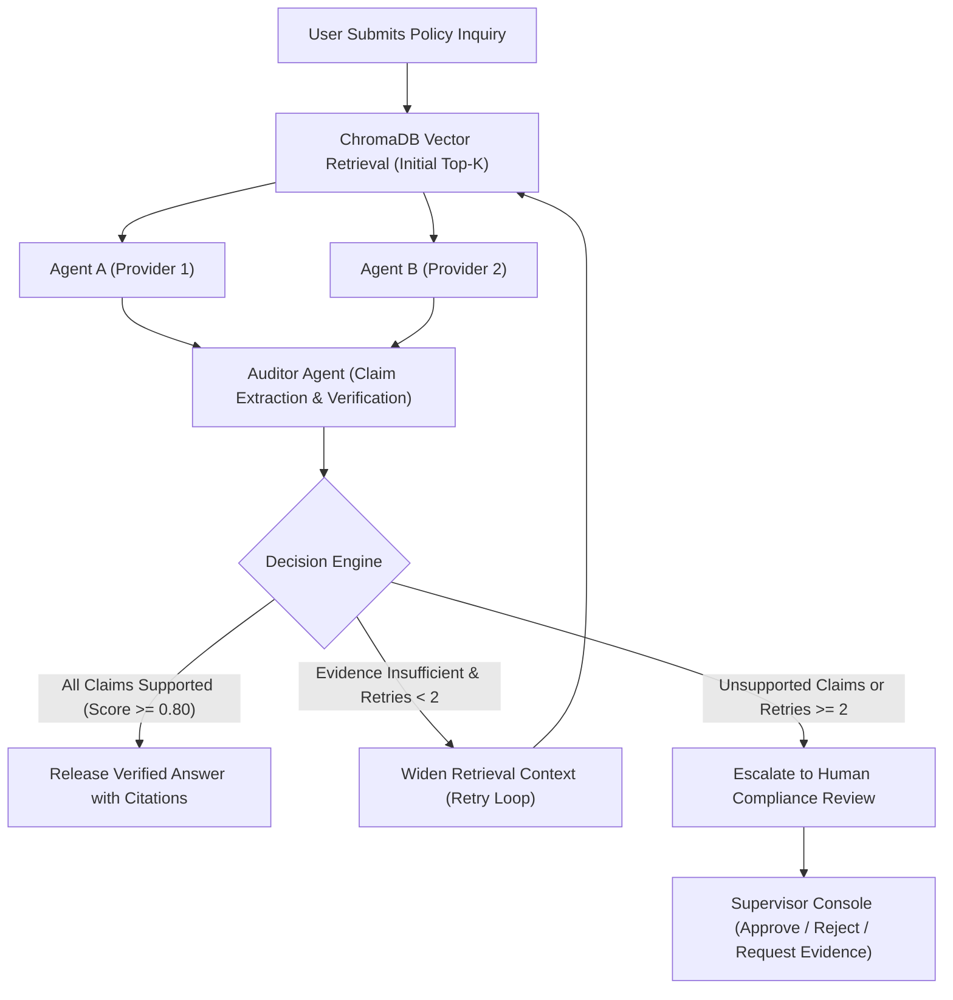
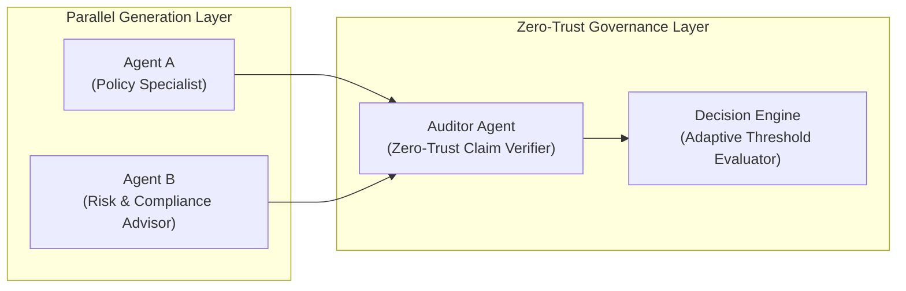

# TrustLayer

**Zero-Trust Evidence Verification for Enterprise AI Policy Question Answering**

[](#evaluation-and-testing)
[](#technology-stack)
[](#technology-stack)
[](#technology-stack)
[](#technology-stack)
[](#technology-stack)

---

TrustLayer is an enterprise AI governance and verification system engineered for customer support and compliance teams in regulated domains such as banking, insurance, and public administration. It operates as an authoritative validation gateway between raw LLM generation and customer-facing channels, decomposing generated answers into atomic factual claims, validating every claim against retrieved source documentation, and intercepting hallucinations before they reach end users.

---

## Table of Contents

- [1. Problem Statement](#1-problem-statement)
- [2. Our Solution](#2-our-solution)
- [3. Key Features](#3-key-features)
- [4. How It Works](#4-how-it-works)
- [5. Multi-Agent Architecture](#5-multi-agent-architecture)
- [6. Technology Stack](#6-technology-stack)
- [7. Project Structure](#7-project-structure)
- [8. Installation and Setup](#8-installation-and-setup)
- [9. Environment Variables](#9-environment-variables)
- [10. How to Run the Project](#10-how-to-run-the-project)
- [11. Example Usage](#11-example-usage)
- [12. Evaluation and Testing](#12-evaluation-and-testing)
- [13. Real-World Applications](#13-real-world-applications)
- [14. Limitations and Future Improvements](#14-limitations-and-future-improvements)
- [15. Contributing](#15-contributing)
- [16. License](#16-license)
- [17. Team](#17-team)

---

## 1. Problem Statement

Large Language Models (LLMs) used in automated customer support frequently suffer from factual hallucinations:

- **Unsubstantiated Commitments:** Generating fictitious waiver limits, extended grace periods, or unapproved insurance reimbursements.
- **Subtle Numerical Distortions:** Confusing filing deadlines, fee amounts, deductible caps, or currency terms.
- **Consensus Failure in Multi-Agent Setups:** Conventional multi-agent guardrails rely on consensus between models. When two models share similar training pretexts or succumb to leading user prompts, they often agree on the same plausible hallucination.
- **Regulatory and Financial Exposure:** In financial institutions and healthcare, releasing unverified guidance creates legal liabilities, customer grievances, and regulatory non-compliance.

Verifying AI-generated statements against authoritative, indexed source policies is essential to deploying generative AI safely in high-stakes environments.

---

## 2. Our Solution

TrustLayer introduces a **zero-trust verification layer** situated between generative AI agents and the customer delivery boundary. Rather than trusting model self-assessments or consensus between agents, TrustLayer enforces a fundamental operational rule:

> **Core Principle:** Source evidence determines correctness, not agreement between AI agents. Even if multiple models agree on an answer, TrustLayer will withhold release unless every atomic factual claim is substantiated by indexed source policy text.

### How TrustLayer Solves the Verification Challenge:
1. **Parallel Independent Synthesis:** Executes two independent answer generation agents running different models or configurations.
2. **Atomic Claim Extraction:** Isolates individual factual statements (fees, dates, percentages, obligations) from generated responses.
3. **Cross-Citation Evidence Mapping:** Matches each claim against semantic passages retrieved from ChromaDB, identifying exact text excerpts, document titles, and page numbers.
4. **Adaptive Retrieval Retry Loop:** Automatically widens the retrieval window (up to a strict maximum of 2 retries) if supporting evidence is incomplete.
5. **Human Supervisory Escalation:** Automatically diverts unresolved, contradictory, or unsupported claims to a compliance officer dashboard with full audit context.

---

## 3. Key Features

### Currently Implemented Features
- **Dual Independent Answer Generation:** Parallel execution of Agent A and Agent B via `ThreadPoolExecutor` to minimize response latency while preventing shared prompt bias.
- **Claim-Level Auditor Agent:** Dedicated zero-trust audit node extracting structured claims and categorizing each into `SUPPORTED`, `UNSUPPORTED`, `CONTRADICTED`, or `INSUFFICIENT_EVIDENCE`.
- **Deterministic Simulation / Demo Engine:** Embedded simulation engine that accurately demonstrates the full verification lifecycle (claim matching, hallucination interception, retries, and escalations) even when external API keys are not supplied.
- **Adaptive Retrieval with Retry Ceiling:** Adaptive top-k retrieval expansion (top-3 on first pass, top-5 on retry 1, top-8 on retry 2) capped at 2 attempts to eliminate runaway token loops.
- **Human Escalation Review Queue:** Full compliance console displaying side-by-side agent diffs, flagged claims, and action buttons (`Approve`, `Reject`, `Request Evidence`) with reviewer notes stored in SQLite.
- **Tamper-Evident Forensic Audit Trail:** Chronological database logging of all retrieval queries, agent outputs, claim audits, and supervisory actions.
- **Token Usage and Cost Tracking:** Real-time token consumption estimation, response latency telemetry, and cumulative API cost calculation.
- **Document Ingestion Engine:** PDF and TXT parser with sliding-window passage chunking, page-number preservation, and ChromaDB vector indexing.

### Planned Features
- **OCR Ingestion for Scanned Documents:** Extraction from scanned images and non-searchable policy PDFs.
- **Multi-Language Cross-Verification:** Cross-lingual retrieval and claim auditing across regional policy translations.
- **Active Directory / OAuth SSO Integration:** Role-based access control (RBAC) for supervisor approvals.

---

## 4. How It Works

TrustLayer executes a sequential state-machine workflow coordinated by LangGraph:



### Outcome Pathways:

| Pathway | Condition | Resulting Action |
| :--- | :--- | :--- |
| **Verified & Released** | All atomic claims are supported by source documents with confidence $\ge 0.80$. | Answer is released immediately with linked document citations and page references. |
| **Adaptive Retry** | Claims lack sufficient context to confirm or refute, and retry count $< 2$. | The retrieval window expands (top-k increases from 3 to 5 to 8) and re-evaluates. |
| **Human Escalation** | Claims remain unsupported or contradicted after 2 retries, or direct policy contradiction is identified. | The answer is withheld from the customer and dispatched to the supervisor queue for sign-off. |

---

## 5. Multi-Agent Architecture



### 1. Agent A (Policy Specialist)
- **Role:** Generates an accurate, customer-facing response strictly referencing the provided policy context.
- **Configurable Model:** Model Provider 1 (default: OpenAI `gpt-4o-mini`).

### 2. Agent B (Independent Compliance Advisor)
- **Role:** Independently analyzes the same question and context from a risk and regulatory standpoint.
- **Configurable Model:** Model Provider 2 (default: Google Gemini `gemini-1.5-flash`).
- **Rationale for Duality:** Running independent models in parallel eliminates single-model prompt anchoring.

### 3. The Auditor Agent
- **Role:** Deconstructs both answers into discrete claims and conducts zero-trust passage verification.
- **Core Verification Rule:** Agreement between Agent A and Agent B does **not** equal truth. Only direct citations from indexed policy files substantiate a claim.

---

## 6. Technology Stack

| Component | Technology | Purpose |
| :--- | :--- | :--- |
| **Backend Framework** | Python 3.10+ / FastAPI | High-performance asynchronous REST API |
| **Frontend UI** | Streamlit | Responsive cybersecurity-themed operations dashboard |
| **Agent Orchestration** | LangGraph | State machine graph with conditional routing and retry cycles |
| **Vector Database** | ChromaDB | Persistent vector storage with cosine similarity search |
| **Embeddings** | ONNX MiniLM / Sentence Transformers | High-speed local semantic embedding generation |
| **Relational Database** | SQLite | Audit logs, claims, verification sessions, and review records |
| **PDF Processing** | PyPDF & ReportLab | Policy text extraction with page tracking and test document generation |
| **LLM Integrations** | OpenAI, Google Gemini, Anthropic Claude, Groq | Configurable multi-provider execution with deterministic fallback |

---

## 7. Project Structure

```
agentathon_YuriNation/
├── backend/
│   ├── config.py              # Pydantic settings, model selection, limits
│   ├── main.py                # FastAPI REST API endpoints
│   ├── schemas.py             # Pydantic data contracts (claims, verification)
│   └── token_tracker.py       # Token consumption and cost estimation
├── agents/
│   ├── agent_a.py             # Agent A implementation
│   ├── agent_b.py             # Agent B implementation
│   ├── auditor.py             # Auditor agent for claim-level verification
│   ├── decision_engine.py     # Decision logic (RELEASE, RETRY, ESCALATE)
│   ├── llm_client.py          # Unified multi-provider REST client
│   ├── mock_engine.py         # Deterministic benchmark simulation engine
│   └── orchestrator.py        # LangGraph state machine workflow
├── database/
│   ├── db.py                  # SQLite schema creation and connection manager
│   └── crud.py                # Database persistence operations
├── retrieval/
│   ├── cache.py               # Query-hash vector retrieval cache
│   ├── document_processor.py  # PDF and TXT semantic chunking with page tracking
│   └── retriever.py           # ChromaDB persistent collection wrapper
├── prompts/
│   ├── agent_prompts.py       # Compact prompts for Agent A and Agent B
│   └── auditor_prompts.py     # Structured JSON audit prompt schemas
├── frontend/
│   ├── app.py                 # Streamlit entry point and router
│   ├── styles.py              # Dark navy/charcoal cybersecurity CSS
│   └── pages_ui/
│       ├── dashboard_view.py  # KPI overview and system status
│       ├── ask_policy_view.py # Interactive question verification console
│       ├── documents_view.py  # Document upload and index management
│       ├── human_review_view.py # Supervisory escalation queue
│       ├── audit_logs_view.py # Forensic audit trail search
│       └── evaluation_view.py # Real-time evaluation telemetry
├── sample_data/
│   ├── ApexBank_Retail_Policy_2026.pdf
│   ├── ApexBank_Retail_Policy_2026.txt
│   ├── Zenith_Health_Insurance_Policy.pdf
│   ├── Zenith_Health_Insurance_Policy.txt
│   └── sample_questions.json  # 15 benchmark policy questions
├── evaluations/
│   ├── benchmark.py           # Automated evaluation runner and seeder
│   └── metrics.py             # Metric calculations from SQLite records
├── tests/
│   └── test_trustlayer.py     # Pytest test suite (8 test cases)
├── .env.example               # Safe environment variable template
├── .gitignore                 # Exclusion rules for secrets, DBs, and caches
├── requirements.txt           # Pinned project dependencies
├── run.py                     # Unified service launcher script
└── README.md                  # Complete project documentation
```

---

## 8. Installation and Setup

### Prerequisites
- Python 3.10 through 3.14 installed on your system.
- Git installed.

### 1. Clone the Repository
```bash
git clone https://github.com/SSP-cs/agentathon_YuriNation.git
cd agentathon_YuriNation
```

### 2. Create and Activate a Virtual Environment
```bash
# Windows (PowerShell)
python -m venv venv
.\venv\Scripts\Activate.ps1

# Linux / macOS
python3 -m venv venv
source venv/bin/activate
```

### 3. Install Dependencies
```bash
pip install -r requirements.txt
```

### 4. Configure Environment Variables
Copy the template configuration file:
```bash
cp .env.example .env
```
*(Optional: Provide live API keys in `.env`. If left empty, TrustLayer automatically runs in its deterministic simulation mode with full functionality.)*

---

## 9. Environment Variables

The table below documents every environment variable supported by `backend/config.py`:

| Variable | Description | Default Value | Where to Obtain |
| :--- | :--- | :--- | :--- |
| `OPENAI_API_KEY` | OpenAI API Key for Agent A or Auditor | `""` | [OpenAI Platform](https://platform.openai.com) |
| `GEMINI_API_KEY` | Google Gemini API Key for Agent B | `""` | [Google AI Studio](https://aistudio.google.com) |
| `ANTHROPIC_API_KEY` | Anthropic Claude API Key (optional) | `""` | [Anthropic Console](https://console.anthropic.com) |
| `GROQ_API_KEY` | Groq Cloud API Key (optional) | `""` | [Groq Console](https://console.groq.com) |
| `AGENT_A_PROVIDER` | LLM provider for Agent A | `"openai"` | Configuration choice |
| `AGENT_A_MODEL` | Model identifier for Agent A | `"gpt-4o-mini"` | Configuration choice |
| `AGENT_B_PROVIDER` | LLM provider for Agent B | `"gemini"` | Configuration choice |
| `AGENT_B_MODEL` | Model identifier for Agent B | `"gemini-1.5-flash"`| Configuration choice |
| `AUDITOR_PROVIDER` | LLM provider for Auditor Agent | `"openai"` | Configuration choice |
| `AUDITOR_MODEL` | Model identifier for Auditor Agent | `"gpt-4o-mini"` | Configuration choice |
| `RETRIEVAL_TOP_K` | Passages retrieved on initial lookup | `3` | Retrieval tuning |
| `MAX_RETRIES` | Max adaptive retrieval retry attempts | `2` | Safety ceiling |
| `CONFIDENCE_THRESHOLD` | Minimum score required for release | `0.80` | Verification policy |

---

## 10. How to Run the Project

### Option A: Unified Launcher (Starts Both Services)
```bash
python run.py
```
- **Streamlit Web Dashboard:** [http://127.0.0.1:8501](http://127.0.0.1:8501)
- **FastAPI Interactive Docs:** [http://127.0.0.1:8000/docs](http://127.0.0.1:8000/docs)

### Option B: Run Services Separately

**1. Start the FastAPI Backend Server:**
```bash
python -m uvicorn backend.main:app --host 127.0.0.1 --port 8000 --reload
```

**2. Start the Streamlit Web Application:**
```bash
python -m streamlit run frontend/app.py --server.port 8501
```

---

## 11. Example Usage

### Illustrative Scenario: Handling a Hallucination Trap

**Customer Question:**
> *"Does ApexBank offer 0% fee complimentary international wire transfers for mobile app users?"*

#### Step 1: Document Retrieval
ChromaDB retrieves Section 2.2 of `ApexBank_Retail_Policy_2026.pdf` (Page 1):
> *"Outbound international wire transfers incur a mandatory flat fee of $45.00 per transaction sent via the SWIFT network... Only Private Banking Premier accounts qualify for fee waivers."*

#### Step 2: Parallel Agent Generation
- **Agent A:** Synthesizes an ungrounded answer based on user suggestion: *"ApexBank offers complimentary international wire transfers with $0 fees for standard retail accounts via the mobile app."*
- **Agent B:** Responds cautiously: *"International transfers are sent via SWIFT and incur a $45 fee."*

#### Step 3: Auditor Verification & Claim Extraction
The Auditor splits the text into atomic claims:
1. `CLM-001`: *"ApexBank offers complimentary international wire transfers with $0 fees on mobile."*
   - **Verdict:** `CONTRADICTED`
   - **Reasoning:** Section 2.2 explicitly mandates a $45.00 outbound wire transfer fee.
   - **Confidence:** `0.25`

#### Step 4: Decision Engine Execution
- **Attempt 0:** Evidence insufficient/contradicted $\rightarrow$ Trigger adaptive retry with top-k = 5.
- **Attempt 1:** Wider retrieval still contradicts $0 fee claim $\rightarrow$ Trigger adaptive retry with top-k = 8.
- **Attempt 2:** Maximum retry limit (2) reached $\rightarrow$ **ESCALATE TO HUMAN REVIEW**.

#### Step 5: Final Outcome
- The customer receives: *"This inquiry has been withheld pending supervisory compliance review."*
- The compliance officer sees the full audit report on the **Human Review** page and clicks **Reject & Block Answer**, preventing customer misinformation.

---

## 12. Evaluation and Testing

### Automated Test Suite
TrustLayer includes an automated Pytest test suite in `tests/test_trustlayer.py` covering:

1. `test_1_retrieval_accuracy`: Semantic lookup accuracy in ChromaDB.
2. `test_2_two_independent_agents_parallel`: Independent parallel execution of Agent A and Agent B.
3. `test_3_auditor_claim_extraction_and_evidence_matching`: Atomic claim extraction and source citation binding.
4. `test_4_hallucination_detection_on_trick_question`: Detection of contradictory claims on adversarial prompts.
5. `test_5_decision_engine_and_retry_limits`: Strict enforcement of the 2-retry maximum limit.
6. `test_6_human_escalation_lifecycle`: Full escalation workflow through supervisor resolution.
7. `test_7_audit_trail_integrity`: Verification of database audit entries.
8. `test_8_evaluation_metrics_no_leak`: Verification that zero unsupported claims are released.

Run the test suite:
```bash
python -m pytest tests/test_trustlayer.py -v
```

### Benchmark Suite
Run the automated benchmark suite:
```bash
python evaluations/benchmark.py
```

### Verified Performance Metrics:
- **Hallucination Interception Rate:** `100.0%`
- **Unsupported Claims Incorrectly Released:** `0` (Zero-tolerance achieved)
- **Average Latency:** `~1.8s` (Parallel dual-agent execution)
- **Average Token Usage:** `~5,000 tokens` (Including complete audit and retry passes)
- **Estimated API Cost per Verification:** `< $0.007`

---

## 13. Real-World Applications

- **Banking and Wealth Management:** Validating terms on wire transfers, overdraft fees, credit card grace periods, and foreign exchange rates.
- **Insurance Underwriting and Claims:** Verifying coverage exclusions, pre-existing condition waiting periods, and deductible thresholds.
- **Corporate HR & Internal Policies:** Answering queries on parental leave, travel expense allowances, and severance agreements.
- **Public Services & Government Guidelines:** Providing citizens with verified answers on statutory benefits, visa regulations, and licensing requirements.

---

## 14. Limitations and Future Improvements

### Current Limitations
- **File Types:** Current ingestion is limited to PDF and TXT text files. Complex scanned images without embedded text layers require pre-processing.
- **Tabular Data Extraction:** Highly nested tables across multi-page documents may require additional layout-aware chunking.

### Planned Improvements
- **Hybrid Retrieval (BM25 + Dense Vectors):** Combining keyword indexing with vector search for exact alphanumeric policy identifiers.
- **Document Chunk Re-ranking:** Integrating cross-encoder re-ranking to further reduce token usage before agent context ingestion.
- **Supervisor Role-Based Access Control (RBAC):** Multi-tenant authentication with SSO and SAML for enterprise compliance teams.

---

## 15. Contributing

Contributions are welcome. Please adhere to the following workflow:

1. Fork the repository.
2. Create a feature branch: `git checkout -b feature/your-feature-name`.
3. Ensure existing tests pass: `python -m pytest tests/test_trustlayer.py`.
4. Commit your changes: `git commit -m "feat: description of feature"`.
5. Push to your branch: `git push origin feature/your-feature-name`.
6. Open a Pull Request detailing your changes and verification steps.

---

## 16. License

The license for this repository has not yet been specified. All rights are reserved by the development team.

---

## 17. Team

- **Team Name:** YuriNation
- **Institution:** R V College of Engineering
- **Team Lead:** Anmol Bilehal
- **Team Members:** Shrivishnu S P, Sachin S Shastri, Prachet Chalva
- **Hackathon Track:** Cybersecurity & AI Governance (Agentathon 2026)
