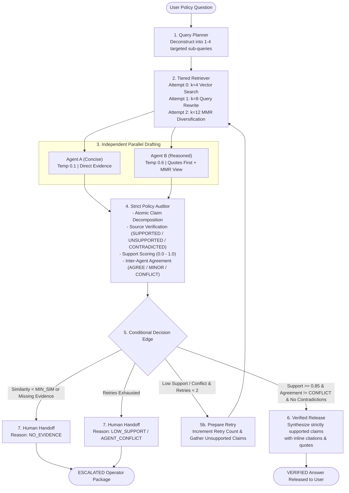

# 🛡️ TrustLayer: Multi-Agent Policy Verification Layer

**Agentathon 2026** | **Track**: Cybersecurity and AI Governance  
**Team**: YuriNation (R V College of Engineering)  
**Team Members**: Anmol Bilehal (Lead), Shrivishnu S P, Sachin S Shastri, Prachet Chalva  

[](https://www.python.org/downloads/)
[](https://github.com/langchain-ai/langgraph)
[](https://www.trychroma.com/)
[](https://opensource.org/licenses/MIT)

**TrustLayer** is an autonomous multi-agent verification system designed for mission-critical enterprise customer-support policies (banking and insurance). Built for a 24-hour Agentathon, it checks every answer claim by claim against the source documents and escalates to a human when it cannot verify, using dual-agent independent drafting, atomic claim auditing, tiered retrieval retry loops, and structured human escalation packages.

---

## 🏛️ System Architecture

TrustLayer models verification as a cyclic LangGraph state machine with explicit retry counters, verifiable citation enforcement, and human-in-the-loop fallback:



---

## ⚡ Quickstart (4 Commands)

```bash
# 1. Clone repository and navigate
cd d:/AGENTATHON

# 2. Install pinned dependencies
pip install -r requirements.txt

# 3. Ingest policy corpus into ChromaDB
python scripts/ingest.py

# 4. Launch the Streamlit UI
streamlit run app.py
```

---

## 🚀 Running the Components

### 1. Interactive Streamlit UI
Launch the interactive dark-themed dashboard:
```bash
streamlit run app.py
```
- **Run Verification**: Select from 8 one-click sample questions (including 3 trick questions) or type your own. View live execution status, side-by-side agent drafts, atomic claim verification table, and verified release or escalation cards.
- **Audit Log**: Inspect immutable past runs, latency metrics, and step-by-step event traces persisted in SQLite.
- **Evaluation Benchmark**: Explore live comparative charts and evaluation matrices comparing Baseline RAG against TrustLayer.

### 2. FastAPI Backend Service
Expose REST API endpoints for enterprise integration:
```bash
uvicorn api:app --host 0.0.0.0 --port 8000 --reload
```
- `POST /ask`: Execute verification pipeline (`{"question": "..."}`).
- `GET /health`: Operational status, current models, indexed chunks.
- `GET /runs`: List historical execution runs from SQLite with optional status filtering.
- `GET /runs/{run_id}`: Retrieve detailed trace, claim breakdown, and timing for a specific run.

### 3. Command-Line Interface (CLI)
Run TrustLayer directly from your terminal:
```bash
python -m trustlayer.cli "What is the fee for non-maintenance on a Nova Classic savings account?"
```
Or pipe questions via stdin:
```bash
echo "What is the waiting period for cataract surgery under Nova Shield?" | python -m trustlayer.cli
```

### 4. Running Tests
Run the comprehensive pytest suite:
```bash
python -m pytest -v
```

### 5. Benchmark Evaluation Runner
Run the benchmark comparing naive RAG, a strict-prompt RAG baseline and TrustLayer (30 questions originally; 117 after `python scripts/expand_hard.py docs`, `python scripts/ingest.py`, `python scripts/expand_hard.py questions`; then `python eval/rejudge.py` re-labels saved answers with a uniform judge):
```bash
python eval/run_eval.py
```
Outputs `eval/results.json`, `eval/results.md`, and the comparative visualization `eval/eval_comparison.png`.

---

## ⚙️ Configuration & Environment Variables

Create a `.env` file in the root directory (see `.env.example`):

| Variable | Default | Description |
| :--- | :--- | :--- |
| `OPENAI_API_KEY` | *(Required)* | OpenAI API key for real mode |
| `ANSWER_MODEL_A` | `gpt-4o-mini` | Cost-efficient model for Agent A |
| `ANSWER_MODEL_B` | `gpt-4.1-mini` | Model for Agent B (must differ from Agent A) |
| `AGENT_B_BASE_URL` / `AGENT_B_API_KEY` | unset | Optional: run Agent B on another vendor via an OpenAI-compatible endpoint (e.g. Gemini) |
| `AUDITOR_MODEL` | `gpt-4o` | High-capability model for Auditor & Finalizer |
| `EMBED_MODEL` | `text-embedding-3-small` | OpenAI embedding model for ChromaDB |
| `MOCK_LLM` | `0` | Set `1` for deterministic offline execution without API keys |
| `CACHE` | `1` | Set `0` to bypass on-disk SQLite response caching |
| `MIN_SIM` | `0.35` | Minimum cosine similarity threshold before escalating as `NO_EVIDENCE` |
| `SUPPORT_THRESHOLD`| `0.85` | Required ratio of supported claims for automated release |
| `MAX_RETRIES` | `2` | Maximum retry loops with expanded retrieval |

---

## 🧠 Key Design Decisions

1. **Genuine Dual-Agent Independence**:
   - Rather than prompting the same model twice, Agent A and Agent B use distinct temperatures (0.1 vs 0.6), contrasting prompting strategies (direct factual vs quotes-first step-by-step), and different retrieval perspectives (top-$k$ vector search vs LLM-rewritten query with Maximal Marginal Relevance).
2. **Strict Atomic Claim Auditor**:
   - The auditor deconstructs generated answers into atomic factual claims and tests them against the retrieved evidence text *only*. External world knowledge is strictly forbidden in the prompt, preventing models from validating claims using plausible generic banking knowledge.
3. **Structured Pydantic Validation & Native Structured Outputs**:
   - All structured model outputs use OpenAI's native `client.beta.chat.completions.parse` with Pydantic schemas, backed by automated fallback to JSON repair prompts.
4. **On-Disk Disk Caching & Tenacity Retries**:
   - Calls to LLM and embedding APIs are cached in an on-disk SQLite database (`.cache/llm_cache.db`) keyed by prompt/schema hash. Repeated questions, evals, and tests run instantaneously at near-zero cost.
5. **Never Release an Unverified Answer**:
   - If evidence is missing, claims are contradicted, or agents conflict on key facts, the system never fabricates. It constructs an actionable `HandoffPackage` containing the conflicting propositions, source chunks, and operator briefings.

---

## 📁 Project Structure

```
AGENTATHON/
├── data/
│   └── policies/               # 6 synthetic Nova Bank & Shield policies (Markdown)
│       ├── savings_account.md
│       ├── credit_card.md
│       ├── personal_loan.md
│       ├── upi_digital_payments.md
│       ├── health_insurance.md
│       └── motor_insurance.md
├── trustlayer/
│   ├── __init__.py
│   ├── config.py               # Dynamic model resolution & settings
│   ├── schemas.py              # Pydantic schemas for state, claims, and handoff
│   ├── llm.py                  # OpenAI wrapper with cache, retry, mock, & parse
│   ├── retrieval.py            # ChromaDB interface with MMR & query rewriting
│   ├── agents.py               # Planner, Agent A, Agent B, Auditor, Finalizer
│   ├── graph.py                # LangGraph StateGraph orchestration & routing
│   ├── audit_db.py             # SQLite persistence for runs, claims, & traces
│   └── cli.py                  # Command-line interface
├── scripts/
│   └── ingest.py               # Chunker and ChromaDB indexer
├── eval/
│   ├── questions.json          # benchmark questions (core set plus generated hard set)
│   ├── run_eval.py             # Benchmark comparison runner
│   ├── results.json            # Empirical eval metrics
│   ├── results.md              # Markdown eval summary report
│   └── eval_comparison.png     # Visual benchmark chart
├── tests/
│   ├── conftest.py
│   ├── test_api.py             # FastAPI endpoint tests
│   ├── test_auditor.py         # Claim decomposition and scoring tests
│   ├── test_graph.py           # LangGraph routing & escalation tests
│   └── test_llm_cache.py       # Caching and embedding tests
├── .env.example
├── pytest.ini
├── requirements.txt
├── run.sh
├── api.py                      # FastAPI application
├── app.py                      # Streamlit dark-theme dashboard
└── README.md
```


---

## Results (extended benchmark)

117 synthetic questions (77 answerable, 40 trap) over 34 policy documents, including look-alike products and superseding circulars. Agent A: `gpt-4o-mini`, Agent B: a Gemini model, Auditor: `gpt-4o`.

| Metric | Naive RAG | Strict-prompt RAG | TrustLayer |
| :--- | :---: | :---: | :---: |
| Wrong answers | 10 | 9 | 2 |
| Trap questions handled (of 40) | 38 | 39 | 40 |
| Answerable answered correctly (of 77) | 68 | 65 | 67 |
| Answerable escalated to a human | n/a | n/a | 8 |
| Time per answer | 1.5s | n/a | 10.3s |
| LLM calls per question | 1 | 1 | about 6 (estimated) |

**Limitations.** The data is synthetic, answers were labeled by an LLM judge (a lite Gemini model for the final labels), and this is a single run. Four answer keys were corrected after reading the source text; first-run labels are kept in `eval/results_first_run.json`. Differences of one or two questions on trap handling are within noise. The remaining wrong answers come from questions that name no product when similar products exist, where the system sometimes picks one silently. TrustLayer is slower and uses about six model calls per answer; of its 8 escalated answerable questions, a baseline was right on 6.
